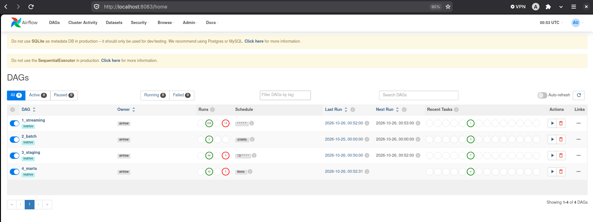
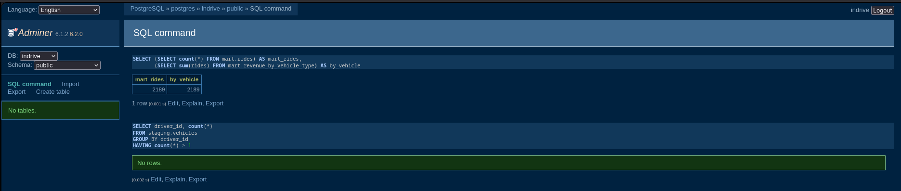
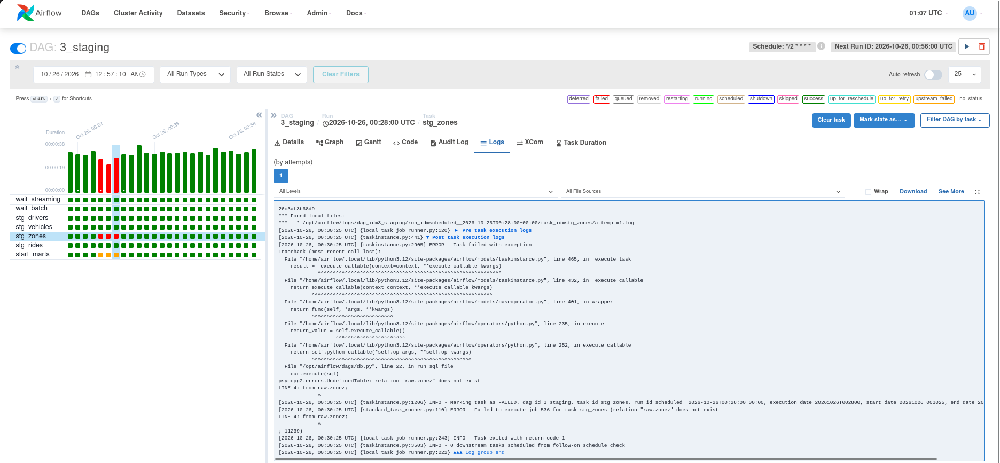

# ANSWERS — InDrive Ride Pipeline (Light version)

_Name: Amina TOUMI_

## Final result

All 4 DAGs are active and their latest runs are green.  


## Q1 — Which sources are **batch** and which is **streaming**? Why does the data team handle them differently? Which one is the **fact** and which are the **dimensions**?

My answer:  
**Batch:** `drivers.csv`, `vehicles.csv` and `zones.csv`. **Streaming:** the dummy API, which gives new rides every minute.

The team handles them differently because streaming data arrives continuously, so something must run all the time to catch it. Batch data changes rarely, so we just reload it on a schedule (daily here).

**Fact:** the rides (from the streaming source). It is an event that happened and it carries numbers we measure (fare, distance). **Dimensions:** drivers, vehicles and zones (from the batch sources). They give the context: who, with what, where.

## Q2 — Is this pipeline **ETL** or **ELT**? Justify in 1-2 sentences, using the 3 layers.

My answer:  
It is **ELT**. The data is loaded as it is in the `raw` schema first, then it is transformed inside Postgres with SQL, to `staging` (cleaning) and then to `mart` (business tables). We didn't transform before loading.

## Q3 — Write the grain of `mart.rides` in one sentence: "one row = ..."

One row = one ride, with the driver who did it, the pickup zone, the dropoff zone, the distance and the fare (names instead of ids).

## Q4 — `staging.zones` is joined twice in `mart.rides`. What do we call this pattern? Why not make two zone tables?

This pattern is called a role-playing dimension: the same table (`zones`) plays two roles for a ride, the pickup and the dropoff. We do not make two tables because we would copy the same data twice, and if a zone name changes we would have to fix it in two places and risk having two different versions. So we keep one table and join it twice with two aliases (`pz` and `dz`).

## Q5 — How many rides are in `raw.rides`, in `staging.rides`? Where did the others go? Why is filtering in staging better than letting the `JOIN` in the mart drop them silently?

My numbers: `raw.rides` = 1920 ; `staging.rides` = 1834

My answer:  
The missing rides (about 4.5%) are the rides with `driver_id = 999`, a driver that does not exist in `drivers.csv`. I checked that there were no rides with `fare_amount <= 0` and no duplicates. A small part of the gap can also come from timing, because new rides arrive every minute and staging only runs every 2 minutes. Filtering in staging is better because the rules are written clearly in one place, while a `JOIN` in the mart would remove these rides without any trace and nobody would know that data was lost.

## Q6 — You re-run `3_staging` three times. Why is there no duplicate? What would happen if the SQL used `INSERT INTO` instead of `DROP` + `CREATE TABLE AS`?

My answer:  
There is no duplicate because `DROP` + `CREATE TABLE AS` deletes the old table and rebuilds it completely from `raw` each time, so the result is the same after 1 run or 3 runs (we say it is idempotent). With `INSERT INTO`, each run would add all the rows again, so the data would be duplicated at every run.

## Q7 — Is `fare_amount` additive, semi-additive or non-additive? And `rating`? What would be wrong with `SUM(rating)`?

My answer:  
`fare_amount` is additive: we can sum it by zone, by driver or by day and the total makes sense. `rating` is non-additive because it is a level, not a quantity. `SUM(rating)` is wrong because 4.5 + 4.8 does not mean 9.3 stars, and the result would just grow with the number of rows. We should use `AVG(rating)` instead.

## Q8 — The back office changes a driver's rating in `drivers.csv` and `2_batch` reloads it. What happens to the **old** rides of this driver in `mart.rides`? Is it correct for InDrive? Which technique would keep the rating the driver had _at the time of the ride_?

My answer:  
The mart is rebuilt from `staging.drivers`, which is reloaded from the CSV, so all the old rides of this driver get the new rating. This is not correct for InDrive if we want to know the rating the driver had when the ride happened. The technique to use is SCD Type 2 (Slowly Changing Dimension): we keep every version of the driver row with `valid_from`, `valid_to` and `is_current`, and each ride is joined to the version that was valid at its `requested_at` date.

## Bonus (optional)

- New mart `mart.revenue_by_vehicle_type`:

```sql
drop table if exists mart.revenue_by_vehicle_type;
create table mart.revenue_by_vehicle_type as
select
    v.vehicle_type,
    count(*) as rides,
    round(sum(r.fare_amount), 2) as revenue
from mart.rides r
join staging.vehicles v on v.driver_id = r.driver_id
group by v.vehicle_type
order by revenue desc;
```

I checked that there is no fan-out: the sum of `rides` is equal to `count(*)` of `mart.rides` (2189 = 2189) and no driver has more than one vehicle.



- Break it (`raw.zonez`): what did you see in the Airflow logs?  
  `stg_zones` turned red and the log said `psycopg2.errors.UndefinedTable: relation "raw.zonez" does not exist` at `LINE 4: from raw.zonez;`. The 3 other staging tasks stayed green because they are independent, but `start_marts` became orange (`upstream_failed`), so `4_marts` did not start. This is good because the marts are not rebuilt from an incomplete staging layer. After I put `raw.zones` back, the next run was green without any manual cleanup, because every run rebuilds the tables from scratch.


